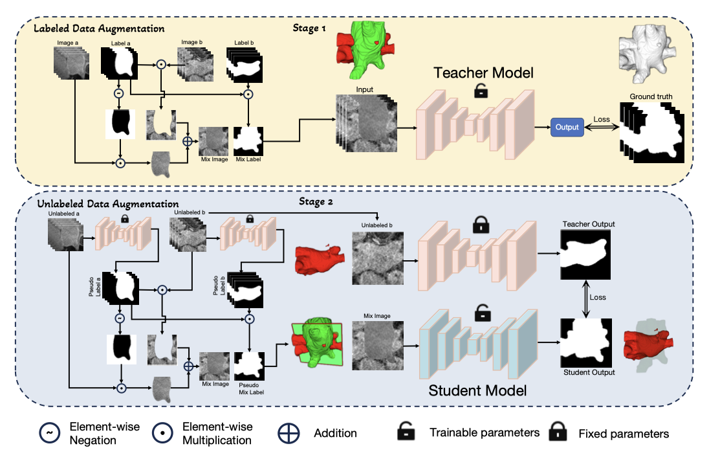
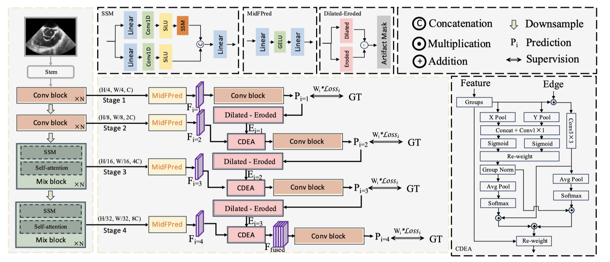
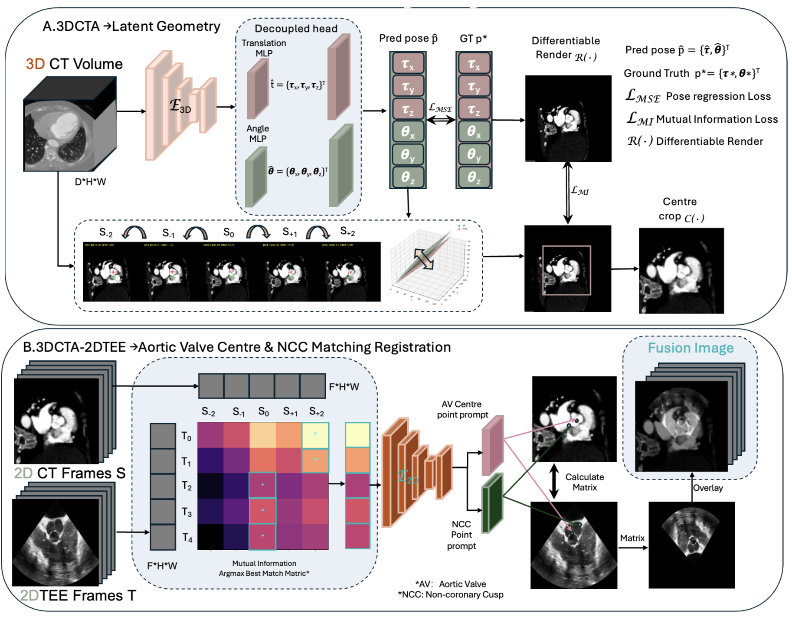








# ‼️🤩**Open to PhD Opportunities (Fall 2027)**

I was a Research Assistant at <strong><a href="https://scupi.scu.edu.cn" target="_blank">Sichuan University-Pittsburgh Institute</a></strong>四川大学匹兹堡学院<strong></strong>, where I focus on deep learning and multimodal image registration on aortic valve replacement medical robot, advised by [Prof. Lixu Gu](https://bme.sjtu.edu.cn/Web/FacultyDetail/37). I obtained my **Master's degree in Computer Technology** from **Yunnan University**云南大学<strong></strong><strong></strong>, advised by [Prof. Wenhua Qian](https://www.ise.ynu.edu.cn/faculty/152/). Before that, I received my **Bachelor's degree in Internet of Things Engineering** from **Yunnan University of Finance and Economics**云南财经大学<strong></strong>.I previously had an internship with <strong><a href="[https://www.hzztai.com](https://www.hzztai.com)" target="_blank">HZZT</a></strong> on pathological image analysis and later joined the <strong><a href="[https://www.hxmedbot.com](https://www.hxmedbot.com)" target="_blank">West China Hospital medical robot</a> Aortic Valve Replacement team</strong><strong></strong> to conduct research on surgical navigation image registration.

My current research involves medical image segmentation, registration and ultrasound-guided surgical navigation. My research interests lie at the intersection of **Medical AI, Computer Vision, and VLA**.

I enjoy exploring challenging research problems, developing practical AI methods. My long-term goal is to contribute to the development of **intelligent medical robots** that can assist surgeons in real-world procedures.

For academic inquiries, research discussions, or potential collaborations, please feel free to reach me at [jiacheng.liu@scai-ji.cn](mailto:jiacheng.liu@scai-ji.cn).

# 🔥 News
- *2025.09*: &nbsp;🎉🎉 Awarded the **FREE Scholar** and joined **Sichuan University** as a Research Assistant.
- *2025.09*: &nbsp;🎉🎉 Graduated with a Master's degree in Computer Technology from **Yunnan University**.
- *2024.07*: &nbsp;🎉🎉 My first-author paper was accepted at **MICCAI 2024**.
- *2024.03*: &nbsp;🎉🎉 Started an Algorithm Internship at **HZZT**（Hangzhou Zhituan Information Technology，杭州智团）, working on AI for digital pathology.

# 📝 Publications

  

    

      
MICCAI 2024

      
    

  

  

**[Overlay Mantle-Free for Semi-supervised Medical Image Segmentation](https://link.springer.com/chapter/10.1007/978-3-031-72117-5_55)**

**Jiacheng Liu**, Wenhua Qian, Jinde Cao, and Peng Liu.
Proposed Overlay Mantle-Free (OMF), a two-stage semi-supervised segmentation framework to address edge uncertainty and shape ambiguity in medical image segmentation. Introduced a teacher–student training strategy where labeled data are first used to sharpen structural boundaries, and frozen teachers generate reliable pseudo labels for unlabeled data to guide student learning. Enabled the model to learn shape-aware representations beyond pixel-wise supervision, achieving superior performance on the Left Atrium dataset with improved boundary accuracy under limited annotations.

  

  

    

      
JBHI Under Review

      
    

  

  

**D2EHNet: Double-Decoupled Edge-Holistic Learning for Aortic Valve Auto-Detection from Artifact-Aware TEE**

**Jiacheng Liu**, Ziyi Wang, Borui Ning, and Lixu Gu.
Proposed D2EHNet, an artifact-aware ultrasound segmentation framework with Channel-Decoupled Edge Attention (CDEA) to explicitly separate boundary and region representations.Introduced boundary-decoupled supervision with morphological artifact masks and hierarchical deep supervision to improve segmentation robustness under severe ultrasound artifacts.Built a TEE aortic valve ultrasound dataset (short-axis & long-axis views) and achieved state-of-the-art performance (Dice 76.53 LAX / 88.57 SAX), outperforming CNN, Transformer, and hybrid segmentation models.

  

  

    

      
Manuscript

      
    

  

  

**Frame-to-Volume Medical Image Registration for Aortic Valve Localization Using 2D TEE and 3D CT**

**Jiacheng Liu**, Faqiang Zhang, and Lixu Gu.
https://github.com/vigilliu/F2V-Net.
Proposed F2VNet, a Frame-to-Volume registration framework that estimates a patient-specific 6DoF plane in 3D CT for 2D TEE–3D CT alignment. Built a registration-oriented dataset using NCC/LCC/RCC landmarks for clinically interpretable plane supervision, and introduced differentiable reslicing with mutual information learning for accurate plane estimation. Further incorporated landmark-guided 2D similarity matching to7.86°nrefine TEE–CT alignment, achieving 8.85 mm translation error, ormal angle error, and 0.418/0.460 MI/SSIM on 18 held-out cases.

  

# 🎖 Honors and Awards
- *2025.09* Sichuan University “FREE Scholar” Scholarship
- *2024.08*: CHINA “Internet+” Provincial Silver Award: “Ancient Rubbings–Digital Preservation of Cultural Relic Rubbings” Utilized edge detection algorithms to extract edges from rubbing and relic photos, preventing secondary damage to the rubbings and relics during manual processing.
- *2024.10*: Second-Class Graduate Scholarship of Yunnan University
- *2023.10*: Third-Class Graduate Scholarship of Yunnan University
- *2023.10*: Mathematical Modeling Participation Award: Huawei Graduate Mathematical Modeling Contest Research on the Correlation Between Hematoma-Perihematomal Edema Modeling and Treatment in Stroke Patients.
- *2022.10* Third-Class Graduate Scholarship of Yunnan University
- *2021–2022*: Inspirational Scholarship of Yunnan University of Finance and Economics

# 📖 Educations
- *2025.09 - 2026.09*, Research Assistant at Sichuan University. Chengdu, China.
- *2022.09 - 2025.06*, Master of Yunnan University. Kunming, China.
- *2018.09 - 2022.06*, Bachelor of Yunnan University of Finance and Economics. Kunming, China.

# 💻 Internships
- *2025.09 - 2026.09* West China Pitech Co., Ltd. [Pitech](https://www.hxmedbot.com), Chengdu, China
- *2024.03 - 2024.07*, Hangzhou Zhituan Information Technology Co., Ltd. [HZZT](https://www.hzztai.com),Hangzhou, China.
